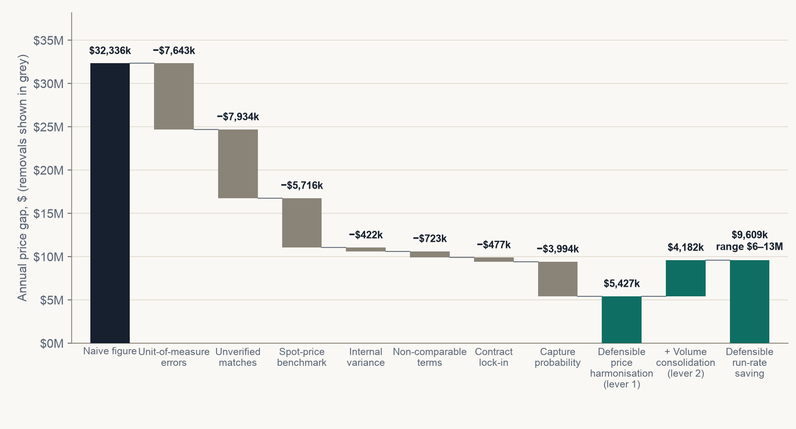
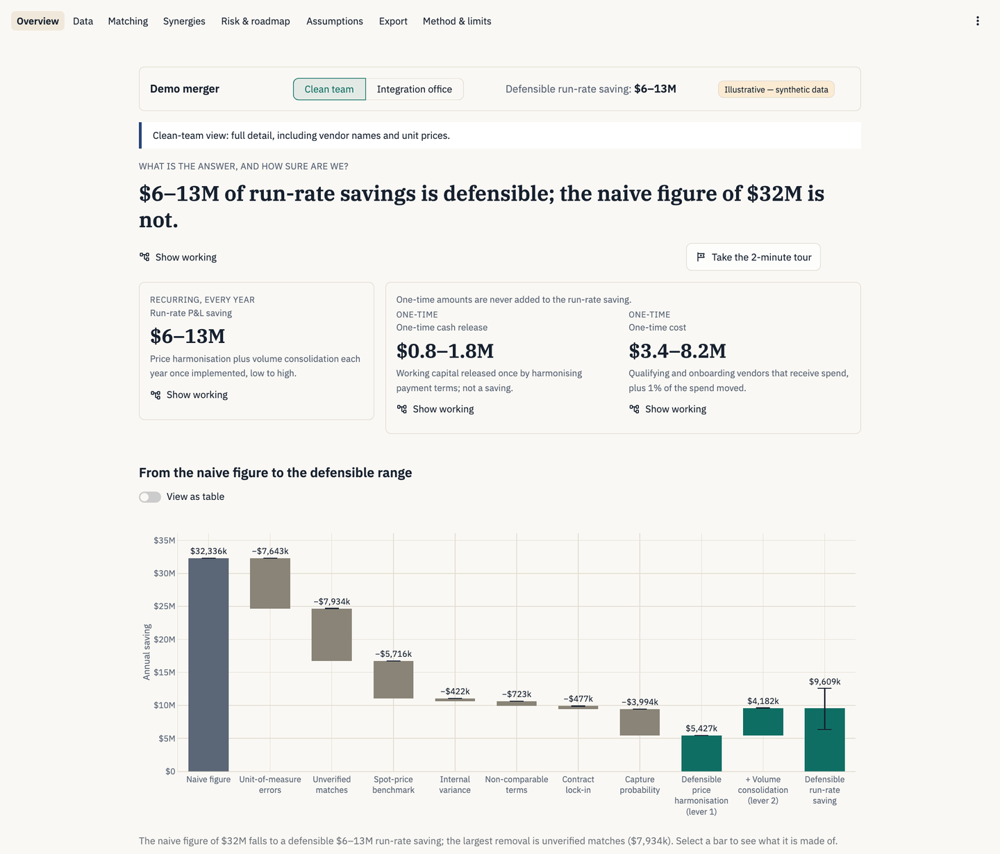
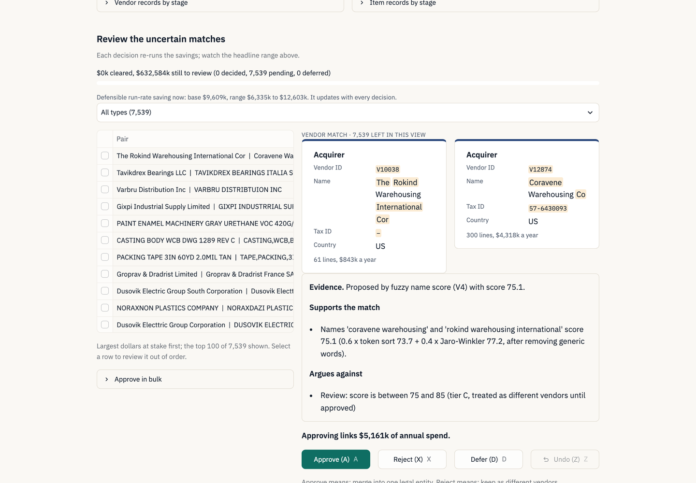
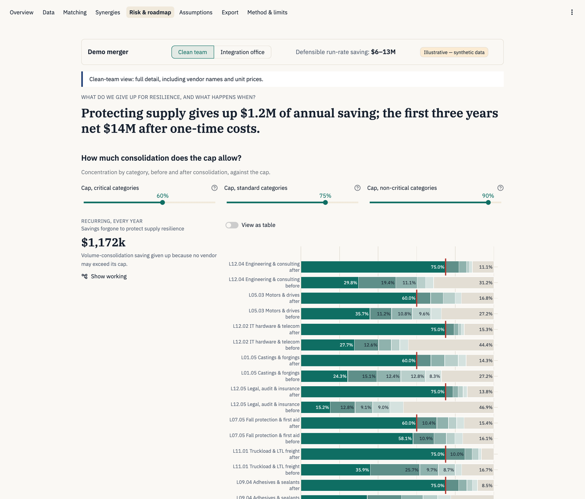

# Tie-Out

Tie-Out sizes the procurement savings of a merger from the two companies' purchasing extracts. It matches vendors and items across them, then walks the naive savings figure down to a defensible range, with every dollar traceable to source rows.

On the demo data (a synthetic merger of about 60,000 purchasing lines and $522M of in-scope spend) the naive figure is $32M and the defensible run-rate saving is $6–13M.



## Screens

The Overview opens on the bridge above and says why the figure shrinks:



The review queue on Matching holds the uncertain pairs, with the evidence for and against each one and the dollars at stake. Every decision re-runs the savings.



Risk & roadmap shows what the concentration caps give up and when the savings arrive:



## Accuracy

Matching is scored against hidden truth on a held-out synthetic dataset (seed 4) that the tool was not tuned on, next to a naive fuzzy-match baseline. Targets are acceptance criteria on that seed, not claims about other data.

| Measure | Tie-Out | Naive baseline | Target |
| --- | --- | --- | --- |
| Vendor precision | 99.6% | 3.3% | at least 98.0% |
| Vendor recall | 96.3% | 94.7% | at least 90.0% |
| Item precision | 98.3% | 35.8% | at least 97.0% |
| Item recall | 83.4% | 49.6% | at least 80.0% |
| Planted-savings recall | 62.2% | 54.2% | none |
| False-savings rate | 0.3% | 17.7% | at most 2.0% |
| Unit-error catch rate | 98.6% | 41.4% | at least 95.0% |

The figures come from `data/demo/scorecard.json`.

## Sample outputs

- [Sample workbook](site/assets/tieout_workbook.xlsx): every figure is a formula over the detail tabs.
- [Sample deck](site/assets/tieout_deck.pptx): eight slides, clean-team view.

Both are generated from the demo data by `make demo`.

## Run it locally

```
pip install -e .
streamlit run app/main.py
```

Python 3.11 or later. The app opens on precomputed demo results, so nothing needs to run before the first screen.

### Command line

The engine runs without the app:

```
python -m tieout run ACQ.csv TGT.csv --out out/ [--mapping map.json] [--category-map F]
    [--vendor-parents F] [--fx F] [--category-settings F] [--assumptions F.toml]
    [--review-decisions F.csv] [--period-end YYYY-MM] [--as-of YYYY-MM-DD]
    [--aggregated] [--view clean|masked] [--no-exports]
```

It writes `out/results/`, `out/tieout_workbook.xlsx` and `out/tieout_deck.pptx`. The exit code is 0 on success and 2 on a blocking validation error, with the report printed.

### Rebuild the demo

```
make demo
```

This generates the held-out seed, scores it, runs the engine and rewrites `data/demo/` and the sample outputs in `site/assets/`.

## What is in the box

- Three levers: price harmonisation, volume consolidation and payment terms (a one-time cash release, never added to the run-rate saving).
- A bridge from the naive figure to the defensible range, each step removing dollars once, with low, base and high cases.
- Traceability: every figure opens to its working, down to the source rows.
- Entity resolution in three tiers (certain, automatic, candidate), a review queue for the candidates, and an accuracy scorecard.
- Two view modes: the clean-team view, and an integration-office view with vendors as codes and no unit prices. It is a presentation mode, not a security control.
- Concentration caps, sole-source flags, phasing, one-time costs and a reconciliation to a top-down reference band.
- Editable assumptions, saved scenarios and a tornado chart of what moves the answer.
- Exports: a formula-driven workbook, an eight-slide deck and static chart images.
- Upload of your own two files, with column mapping, validation and a category map.

## What it cannot see

The analysis works from purchasing lines and nothing else. It does not see:

- rebates, credits and off-invoice discounts;
- specification, quality and lead-time differences between apparently identical items;
- freight and delivery terms, unless incoterms are supplied;
- contract clauses such as minimum volumes, exclusivity and change of control;
- index-linked prices caught at different dates;
- supplier capacity and willingness to serve the combined volume;
- services and other spend with neither an item code nor a manufacturer part number, beyond vendor and category totals;
- corporate parent links that are not in the parent table.

## What already exists

This workflow is not new. Consulting firms run it with proprietary tooling, spend-analytics vendors sell classification and supplier resolution, and general tools such as Excel fuzzy merge, Alteryx, OpenRefine and Splink cover the matching step. What Tie-Out offers is an open implementation in which each matching rule and formula can be read and every dollar audited.

## Data

All data in this repository is synthetic. The companies, vendors, items and prices are generated by `synthetic/` and describe no real business. Any resemblance to a real name is a coincidence.

## Development

```
pip install -e ".[dev]"
make lint test
```

`make lint` runs ruff (check and format); `make test` runs pytest. Tests use the small generated dataset; the held-out seed is regenerated byte-identically when a test needs it.

Repository layout:

```
tieout/          the engine: ingest, normalise, match, synergy, export, views, results
synthetic/       data generator, name denylist, truth writer (never imported by tieout/)
evaluation/      scorecard, tuning, baseline matcher, sensitivity
app/             Streamlit app: main.py, screens/, components/, static/
site/            static landing page, sample outputs, config.js
tests/           unit, app and site tests
data/demo/       generated demo files, precomputed results, scorecard.json
data/truth/      truth files per seed, read only by evaluation/
docs/            PRD.md, ARCHITECTURE.md, screenshots/
HUMAN_TODO.md    tasks left to the owner
BUILD_NOTES.md   decisions and shortfalls recorded during the build
```

Conventions: pull requests are squash-merged and their titles follow Conventional Commits (`feat`, `fix`, `docs`, `test`, `refactor`, `perf`, `build`, `ci`, `chore`). See [CONTRIBUTING.md](CONTRIBUTING.md). The product requirements are in [docs/PRD.md](docs/PRD.md) and the module contracts in [docs/ARCHITECTURE.md](docs/ARCHITECTURE.md).

## Licence

MIT. See [LICENSE](LICENSE).
